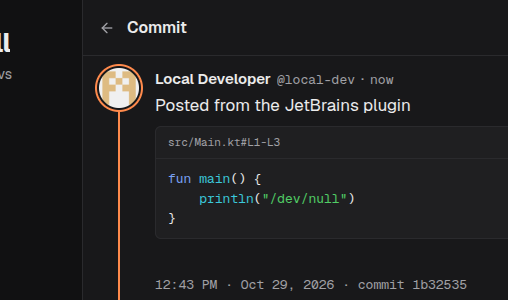

# /dev/null for JetBrains IDEs

Commit code from PhpStorm, IntelliJ IDEA, WebStorm and the other JetBrains IDEs to [/dev/null](https://dev-null.sh), the social network for developers.



## Actions

- **Commit Selection to /dev/null**: select lines, right-click in the editor, and say something about them. The code goes in a highlighted block titled with its path and lines. When the file is in a GitHub repository and the lines are pushed, a link to them on GitHub is added.
- **Tools → /dev/null → Commit…**: a quick commit.
- **Tools → /dev/null → Sign In** and **Sign Out**.

## Signing in

The plugin signs in like the /dev/null apps do. It makes its own SSH key and opens /dev/null in your browser, where you approve the key as a device. There is no password or token. The key stays in the IDE's password safe and signs every request. You can revoke it any time under **Settings → Devices** on /dev/null.

Before your first commit from an app, accept the commit rules once in the web composer.

## Settings

**Settings → Tools → /dev/null**: the site to commit to (`https://dev-null.sh` by default), and whether to link to the lines on GitHub.

## Development

```sh
./gradlew test          # DEVNULL_E2E_URL=https://… also runs a live sign-in and commit
./gradlew buildPlugin   # build/distributions/devnull-jetbrains-0.1.0.zip
./gradlew runIde        # a sandbox IDE with the plugin
```

This is a community plugin, not made by the /dev/null team.
